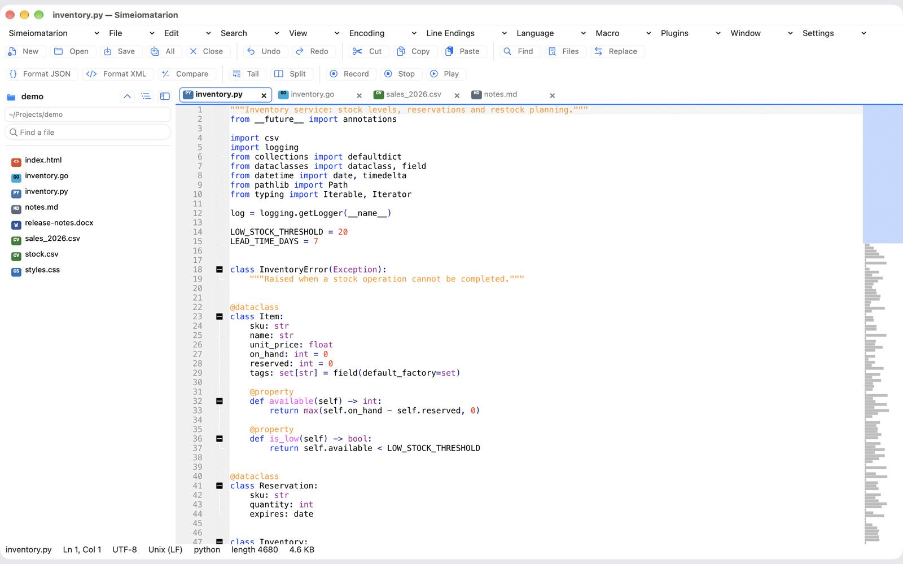
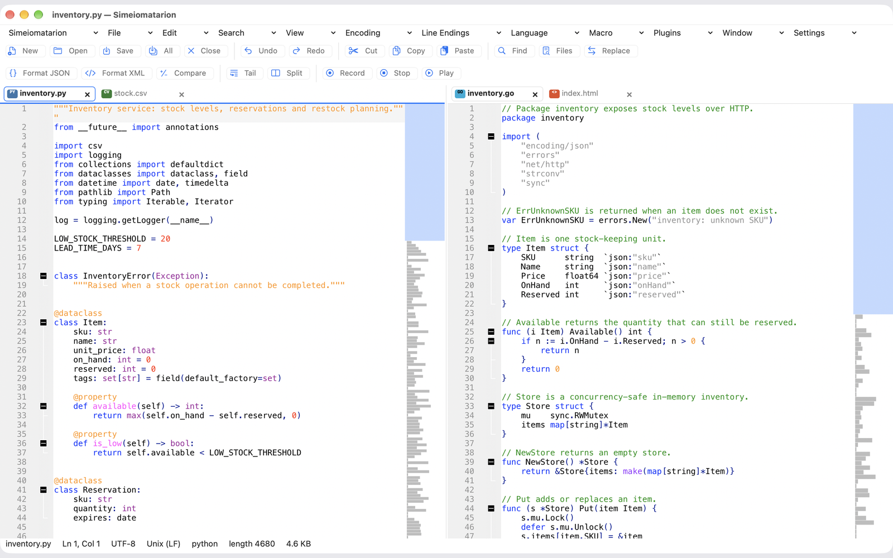
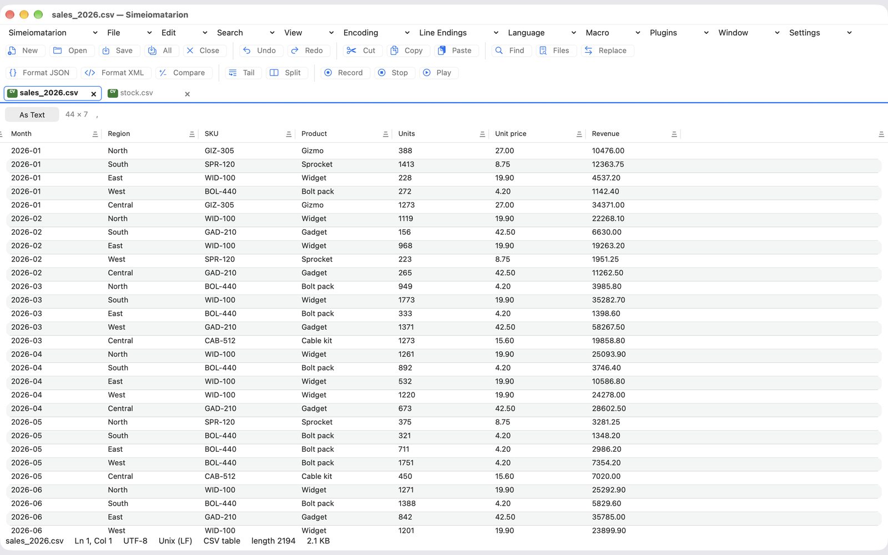
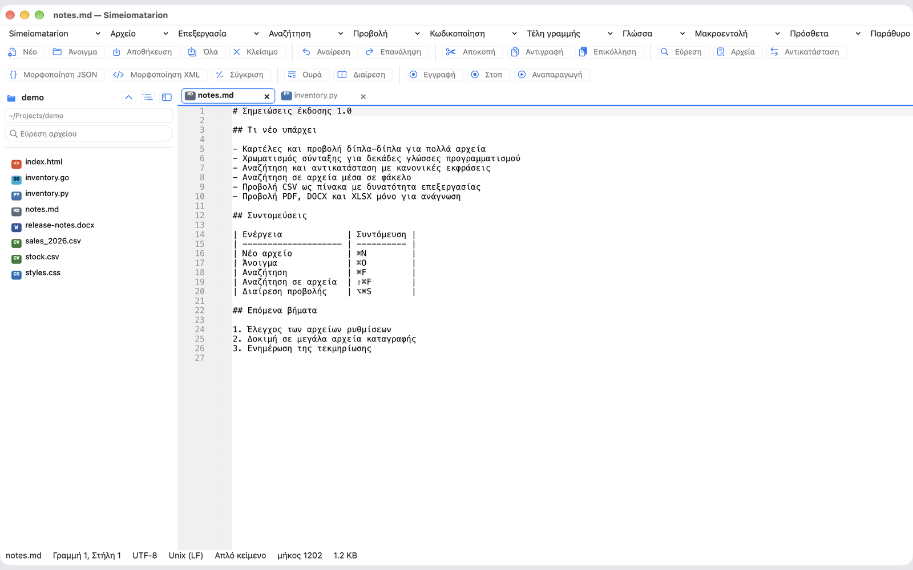

# Simeiomatarion

Simeiomatarion is a native text and code editor for Apple Silicon Macs: tabs, side-by-side panes, syntax highlighting for dozens of languages, regular-expression search, and table and document views for CSV, PDF and Word files.



## Screenshots

| | |
| --- | --- |
|  |  |
| Two panes side by side, each with its own tabs | A CSV file opened as an editable table |
|  | |
| The interface in Greek | |

## Build

Command Line Tools are enough. Full Xcode is not required.

The editing engine is compiled from the third-party source tree at `upstream/` (see [`NOTICE`](NOTICE)), which is not stored in this repository. The Makefile runs [`scripts/fetch-upstream.sh`](scripts/fetch-upstream.sh) to fetch it at the pinned commit when it is missing. You can also run that script yourself.

Run this from the repository root.

```sh
cd macos
./build.sh
open "build/Simeiomatarion.app"
```

Or, without rebuilding, from the `macos` folder:

```sh
open "build/Simeiomatarion.app"
```

`make test` also runs `build/port_tests`.

The version is in [`VERSION`](VERSION) and the build number in [`BUILD_NUMBER`](BUILD_NUMBER). See [Version in macos/README.md](macos/README.md#version) for how to bump it, and [`CHANGELOG.md`](CHANGELOG.md) for what changed.

## What you can do

- Edit several documents in tabs
- Drag one or more files onto the window, or onto the Dock icon, to open each in a tab
- Syntax highlighting and code folding through Lexilla, using the bundled `langs.model.xml`
- Find, find previous, replace, and replace all
- Regular expressions through Boost.Regex (`SCFIND_REGEXP | SCFIND_POSIX`)
- Record, stop, play, and persist one macro
- UTF-8, UTF-8 with BOM, UTF-16 LE, UTF-16 BE, and Windows-1252
- CRLF, CR, and LF, including conversion
- Font, tab width, spaces, wrap, line numbers, and whitespace settings
- Menu shortcuts stored as `command=keys` lines in Preferences
- Session restore, and recovery of dirty buffers every 30 seconds
- A native plugin (`PlugIns/SamplePlugin.dylib`, Plugins → Uppercase Selection)

Settings, macros, recovery files, and extra plugins live in `~/Library/Application Support/Simeiomatarion/`. On first launch, settings from the folder used by builds before 1.0.0 are copied there. Drop extra `dylib` files in the `plugins` folder there.

## License

Licensed under GPL-3.0. Third-party notices: see [NOTICE](NOTICE).
